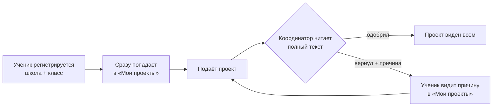
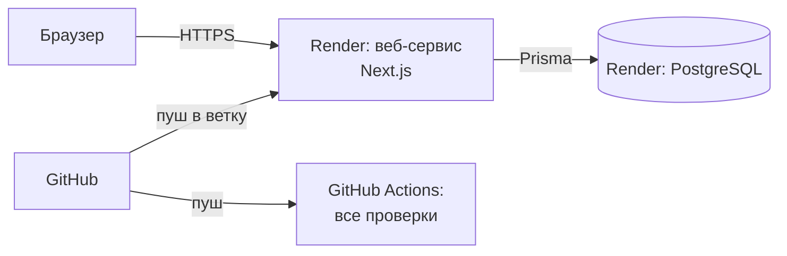

# Talent to Impact — полное описание проекта

> Прочитав этот файл, человек без знания кода должен понять: что это за сайт, кто им пользуется, что на нём можно сделать, как он устроен внутри, где живёт и как его менять.
> Подробности для разработчиков с диаграммами — в [`docs/ARCHITECTURE.md`](docs/ARCHITECTURE.md).

**Сайт:** https://talent-to-impact.onrender.com
**Код:** GitHub `azizbekforgit-sudo/Aziz-s_2-projects`, ветка `claude/wonderful-archimedes-busje5`
**Языки сайта:** узбекский (по умолчанию) и русский

---

## 1. Что это в двух словах

Talent to Impact — сайт для школьников 7–11 классов Узбекистана. Пилот проходит в Навоийской области.

Ученик регистрируется и сразу может работать. Он видит проблему в своей школе или махалле (мутная вода в арыке, нет тени во дворе, неудобное расписание…), описывает её и своё решение — это и есть **проект**. Координатор проверяет проект: одобряет его или возвращает с комментарием, что исправить. Одобренный проект публикуется, и его видят другие школы.

Кроме проектов на сайте есть раздел **«Конкурсы и стипендии»**: координаторы добавляют туда олимпиады, гранты и программы для школьников.

---

## 2. Зачем он нужен

Идея из исходной спецификации (Master Specification 2.0) — провести ученика по пути **«открой → развивайся → создавай → делись»** через четыре механизма:

| Механизм | Что это | Состояние |
|---|---|---|
| **School Hack 72** (создавай) | Ученик превращает реальную проблему в проект | ✅ Работает: подача, проверка, публикация проектов. Сами 72-часовые хакатоны с командами пока не сделаны |
| **Opportunity Relay** (делись) | Конкурсы, стипендии, программы | ✅ Работает: координатор добавляет, ученики видят |
| **Talent Map** (открой) | Анкета о сильных сторонах по 8 направлениям | ⏳ Страница «Скоро». Ждёт утверждения методики — придумывать баллы нельзя |
| **Knowledge Bridge** (развивайся) | Занятия «ученик — ученику», библиотека | ⏳ Страница «Скоро». Нужны модерация и проверка файлов |
| Менторство | Наставники из вузов и компаний | ⏳ Страница «Скоро». Нужны проверка наставников и правила общения с несовершеннолетними |

---

## 3. Кто пользуется

| Кто | Что может |
|---|---|
| **Гость** (без входа) | Смотреть главную, одобренные проекты, конкурсы; зарегистрироваться |
| **Ученик** (`STUDENT`) | Подавать проекты, видеть их статус и комментарии проверяющего |
| **Региональный координатор** (`REGIONAL_COORDINATOR`) | Видит панель модерации, но решения не принимает |
| **Администратор** (`ADMIN`, `SUPER_ADMIN`) | Проверяет проекты, добавляет конкурсы |

В базе есть ещё роли `MENTOR` и `TEACHER` — они заготовлены под будущие модули и сейчас ничего особенного не дают.

**Главный администратор** создаётся автоматически при запуске сервера из переменных `SEED_ADMIN_EMAIL` и `SEED_ADMIN_PASSWORD` (они хранятся в настройках сервиса на Render, не в коде).

---

## 4. Все страницы сайта

| Адрес | Кто видит | Что там |
|---|---|---|
| `/` | все | Главная: заголовок, «лист тетради» с примером проекта, как это работает, новые проекты, что появится дальше |
| `/projects` | все | Одобренные проекты |
| `/projects/<id>` | одобренный — все; на проверке — только автор и админы | Полный текст проекта (кратко, проблема, решение), штамп статуса. У администратора здесь же форма решения |
| `/opportunities` | все | Конкурсы и стипендии (просроченные скрыты) |
| `/register` | гости | Регистрация ученика: имя, email, пароль, школа, класс |
| `/login` | гости | Вход |
| `/dashboard` | ученик | «Мои проекты»: статус каждого и комментарий проверяющего |
| `/projects/new` | ученик | Подать проект |
| `/admin` | админы | Модерация: проекты на проверке, форма добавления конкурса, журнал решений |
| `/talent-map`, `/community`, `/mentorship` | вошедшие | Честные страницы «Скоро»: что будет и почему пока закрыто |

Вошедшего пользователя страницы `/login` и `/register` сразу отправляют дальше. Администратора `/dashboard` отправляет в `/admin`.

---

## 5. Главный путь — от регистрации до публикации



1. **Регистрация.** Имя, email, пароль, школа и класс. Аккаунт создаётся сразу активным, ученик автоматически входит и попадает в кабинет. Подтверждать аккаунт координатору **не нужно**. Через форму нельзя стать администратором.
2. **Проект.** Название, категория, кратко (обязательно), проблема и решение (по желанию). Проект уходит «На проверку».
3. **Проверка проекта координатором.** «Одобрить» публикует проект. «Вернуть на доработку» возможно только с комментарием, и ученик его видит.
4. **Публикация.** Одобренный проект виден в `/projects` и на главной. Автор показан как «Азиза К. · 9 класс».

Каждое решение администратора записывается в **журнал решений**.

## 6. Как устроено технически

### 6.1 Из чего сделано

| Часть | Технология |
|---|---|
| Сайт и сервер | **Next.js 15** (React 19, TypeScript) — один проект, страницы рендерятся на сервере |
| База данных | **PostgreSQL 16**, работа с ней через **Prisma** |
| Вход | **Auth.js** (next-auth v5): email + пароль, пароль хранится как bcrypt-хэш |
| Проверка форм | **zod** — одни и те же правила для всех форм |
| Оформление | Собственный CSS-файл с токенами (`src/app/globals.css`), без UI-фреймворков |
| Шрифты | Golos Text (интерфейс) и Literata (заголовки) — оба с кириллицей и узбекской латиницей |
| Тесты | Vitest (логика), Playwright + axe (браузер, доступность) |
| Хостинг | **Render** (Франкфурт): веб-сервис + база |
| Автопроверки | **GitHub Actions** при каждом пуше |

### 6.2 Общая схема



### 6.3 Папки

```
PROJECT.md            ← этот файл
README.md             ← кратко + как запустить (англ.)
CLAUDE.md             ← правила для ИИ-ассистента, работающего с кодом
docs/ARCHITECTURE.md  ← подробная архитектура с диаграммами
render.yaml           ← описание хостинга на Render (сервис + база)
.github/workflows/    ← автопроверки при каждом пуше
.claude/skills/unslop ← дизайн-скилл, по которому сделан интерфейс

prisma/
  schema.prisma       ← ВСЕ таблицы базы данных
  seed.ts             ← создаёт регион Навои, главного админа, 8 компетенций

src/
  app/                ← СТРАНИЦЫ (папка = адрес в браузере, см. раздел 4)
  components/         ← переиспользуемые куски интерфейса (шапка, меню, поля форм, штамп…)
  lib/                ← ЛОГИКА без интерфейса: правила форм, роли, доступ, регистрация, журнал
  i18n/               ← ПЕРЕВОДЫ: ru.ts (эталон) и uz.ts
  auth.ts             ← вход по паролю
  auth.config.ts      ← лёгкая часть настроек входа (для middleware)
  middleware.ts       ← «охранник»: без входа не пускает в кабинет и админку

tests/
  unit/               ← быстрые тесты логики
  e2e/                ← тесты в настоящем браузере
```

**Правило слоёв:** страница (`app/`) вызывает логику (`lib/`), логика ходит в базу. Компоненты (`components/`) только рисуют.

### 6.4 Самые важные файлы логики

| Файл | За что отвечает |
|---|---|
| `src/lib/validators.ts` | Все правила форм: длина имени, пароль ≥ 10 символов, класс 7–11, обязательная причина отказа, ссылки только `https://`… |
| `src/lib/roles.ts` | Кто админ, кто модератор. Единственное место со списками ролей |
| `src/lib/session.ts` | `requireUser()` / `requireRole()` — проверка доступа **по базе** на каждой защищённой странице |
| `src/lib/users.ts` | Регистрация ученика |
| `src/app/admin/actions.ts` | Решения администратора: подтвердить аккаунт, решение по проекту, добавить конкурс |
| `src/lib/rate-limit.ts` | Защита от подбора пароля |
| `src/lib/audit.ts` | Запись в журнал решений |

### 6.5 База данных

Используемые сейчас таблицы:

| Таблица | Что хранит |
|---|---|
| `User` | Ученики и администраторы: имя, email, хэш пароля, роль, статус (ждёт / активен / отключён), школа, класс, язык |
| `Project` | Проекты: название, категория, кратко, проблема, решение, статус, комментарий проверяющего, автор |
| `Opportunity` | Конкурсы и стипендии: название, организатор, тип, срок, ссылка, описание |
| `AuditLog` | Журнал решений: кто, какое действие, над чем, когда |
| `Region`, `Competency` | Регион Навои и 8 компетенций (заготовка для Talent Map) |

Остальные таблицы в схеме (хакатоны, команды, ответы Talent Map, XP, уведомления, менторство) **заготовлены** под будущие модули и пока не используются.

Статусы проекта: `PENDING_REVIEW` (на проверке) → `APPROVED` (одобрено) или `REJECTED` (на доработку). Публично видны только одобренные.

---

## 7. Безопасность и защита учеников

- **Пароли** хранятся только как bcrypt-хэш.
- **Подбор пароля:** после 5 неудачных попыток вход для этого email закрыт на 15 минут.
- **Доступ** проверяется по базе на каждой странице и в каждом действии, а не по cookie. Заблокированный пользователь теряет доступ сразу.
- **Права администратора** проверяются внутри каждого действия на сервере: спрятанная кнопка — это не защита.
- **Регистрация** всегда создаёт только ученика со статусом «ждёт подтверждения».
- **Несовершеннолетние:** публично показываются только «Имя Ф. · класс». Полное имя и школу видят только администраторы.
- **Неодобренный проект** для посторонних отдаёт «страница не найдена», чтобы даже не раскрывать, что он есть.
- **Ссылки в конкурсах** принимаются только `http(s)://` (нельзя вставить вредоносный `javascript:`).
- **Перенаправление после входа** — только на страницы этого же сайта.
- **Двойное решение** двух администраторов по одной заявке невозможно (решение и запись в журнал — одна транзакция).
- **Секреты** (ключ сессий, пароль админа, адрес базы) хранятся в настройках Render, в коде их нет.

---

## 8. Языки

- По умолчанию **узбекский** (латиница), переключатель **UZ | RU** есть в шапке, в кабинете и на странице входа. Выбор запоминается (cookie `lang`).
- Все тексты лежат в двух файлах: `src/i18n/ru.ts` (эталон) и `src/i18n/uz.ts`. Если добавить строку в один и забыть в другом — проект не соберётся, а тест укажет, где дыра.
- Ошибки форм тоже переводятся: правила возвращают не текст, а ключ, текст берётся из словаря.
- ⚠️ Узбекский перевод сделан ИИ — перед показом школам его стоит вычитать носителю языка.

---

## 9. Дизайн

Концепция **«Impact Atlas» — атлас реальных изменений**: редакционный журнал (крупная типографика, ясная сетка) плюс инженерный полевой блокнот (тёплая бумага, тонкая сетка, нумерация разделов, чернильные штампы).

- **Цвета:** тёплая бумага, глубокие чернила `#17283F`, один синий акцент `#315FE8`. Зелёный, янтарный и красный — только для статусов и ошибок.
- **Шрифты:** Literata для крупных заголовков, Golos Text для интерфейса.
- **Фирменные детали:**
  - лист проекта в клетку;
  - контурные линии;
  - тонкая синяя линия пути, которая соединяет шаги;
  - нумерация 01/02/03;
  - штамп статуса («На проверке», «Одобрено», «На доработку»), всегда с иконкой и словом.
- **Анимация:**
  - hero «ложится на стол» один раз за сессию;
  - блоки мягко появляются при прокрутке;
  - карточки чуть приподнимаются при наведении.
  
  Всё отключается системной настройкой «уменьшить движение», а без JavaScript контент всё равно виден.
- **Состояния:** скелетоны загрузки, страница «не найдено», страница ошибки, пустые состояния с иллюстрацией.
- **Доступность:** контраст WCAG AA (два цвета из ТЗ немного затемнены, иначе не проходили), работа с клавиатуры, подписи полей, кнопка «показать пароль», вёрстка от 375px.

## 10. Где живёт и сколько стоит

| Что | Где | Тариф |
|---|---|---|
| Сайт | Render, сервис `talent-to-impact`, Франкфурт | Starter, ~$7/мес |
| База | Render, `talent-to-impact-db`, PostgreSQL 16 | basic-256mb, ~$6/мес |

- **Деплой автоматический:** пуш в ветку `claude/wonderful-archimedes-busje5` → Render собирает и запускает новую версию за 2–4 минуты.
- При запуске сервер сам приводит базу к `schema.prisma` (опасные изменения, удаляющие данные, он **отказывается** делать — деплой упадёт, данные целы) и создаёт главного админа, если его нет.
- Логи и статус: Render Dashboard → `talent-to-impact` → Logs / Events.
- Вкладка браузера, открытая до обновления, при следующем клике сама перезагружается на новую версию.

---

## 11. Качество: что проверяется автоматически

| Команда | Что проверяет |
|---|---|
| `npm run check` | Схема базы корректна, линтер (в т.ч. запрет инлайн-стилей), типы TypeScript, 30 unit-тестов |
| `npm run test:e2e` | 30 тестов в настоящем браузере: весь путь ученика (включая возврат с причиной и повторную подачу), отклонённый аккаунт, добавление конкурса, защита от подбора пароля, переключение языка, доступность и мобильная вёрстка на двух языках, отсутствие JS-ошибок |
| `npm run test:live` | Безопасные проверки прямо на живом сайте |

Те же проверки запускает GitHub Actions на каждый пуш. **Красный CI = не выкатывать.**

---

## 12. Как запустить у себя и как вносить изменения

```bash
cp .env.example .env      # заполнить AUTH_SECRET и SEED_ADMIN_PASSWORD
docker compose up -d      # база PostgreSQL
npm install
npm run db:push           # создать таблицы
npm run db:seed           # регион + главный админ
npm run dev               # http://localhost:3000
```

Как добавлять новое (подробно — `docs/ARCHITECTURE.md`, раздел «Как сделать…»):

- **Новая страница:** папка в `src/app/<адрес>/page.tsx`; для вошедших — `requireUser()` + `<AppShell>`, для всех — `<PublicPage>`.
- **Новая форма:** правило в `lib/validators.ts` → действие `actions.ts` рядом со страницей → форма через поля из `components/form-fields.tsx` → тесты.
- **Новый текст:** ключ в `src/i18n/ru.ts`, затем в `uz.ts`.
- **Новое поле в базе:** `prisma/schema.prisma` → `npx prisma format` → `npm run db:push` → пуш.
- **Перед каждым пушем:** `npm run check` (и `npm run test:e2e`, если менялся интерфейс).

---

## 13. Демонстрационные данные

На сайте 12 **демо-проектов** от 12 демо-учеников (узбекские имена, школы Навоийской области). Их создаёт `prisma/demo.ts` при каждом запуске сервера, повторно ничего не дублируется.

- Демо-аккаунты имеют email на `@demo.talenttoimpact.uz` и случайный неизвестный пароль, войти под ними нельзя.
- Скрипт один раз (отметка в журнале `maintenance.reset-test-data-2026-11`) удалил старые тестовые аккаунты учеников и их проекты.
- ⚠️ Перед показом настоящим школам демо-данные стоит убрать: удалить пользователей с email на `@demo.talenttoimpact.uz` (их проекты удалятся вместе с ними) и убрать вызов `prisma/demo.ts` из `start:prod` в `package.json`.

## 14. Что ещё не сделано (честно)

- Talent Map, Knowledge Bridge, менторство (страницы «Скоро»)
- Хакатоны School Hack 72 с командами, спринтами и жюри
- XP, бейджи, рейтинги, сертификаты
- Сброс пароля по email и подтверждение email
- Смена пароля в интерфейсе (главному админу стоит сменить пароль — сейчас это делается только через базу)
- Редактирование проекта после возврата (сейчас ученик подаёт исправленный проект заново)
- Привязка учеников к справочнику школ и районов (сейчас школа — свободный текст)
- Согласие родителей и политика хранения данных несовершеннолетних — нужна проверка юристом
- Защита от подбора пароля работает в памяти одного сервера; при нескольких серверах её нужно перенести в базу
