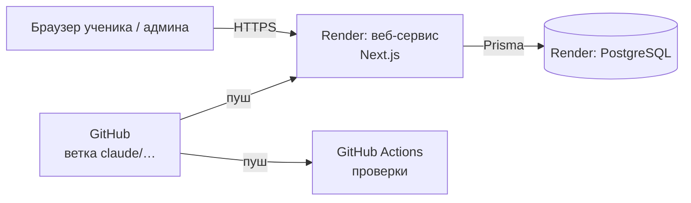
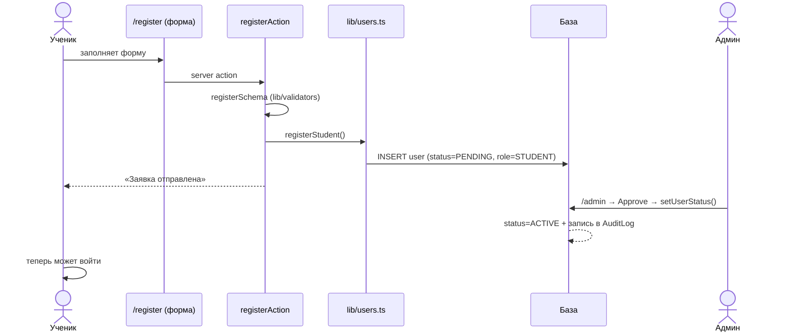
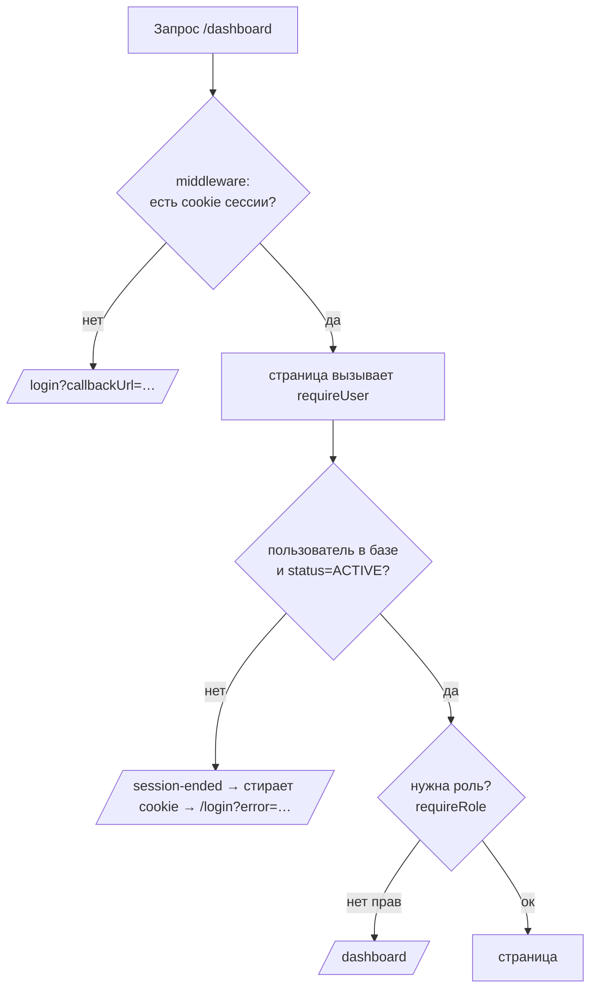
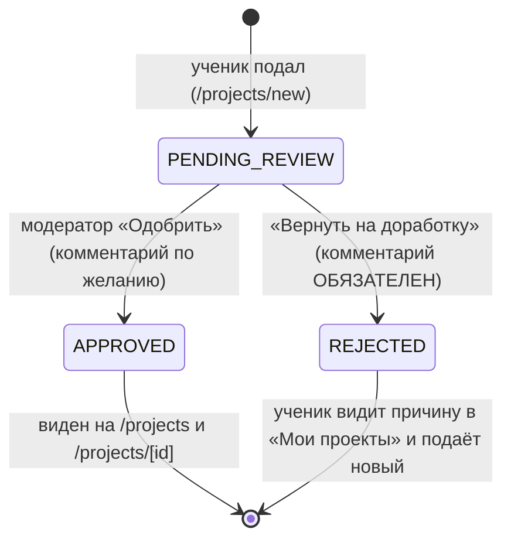
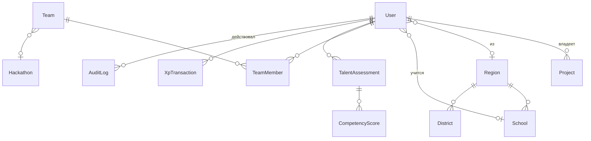

# Как устроен TALENT TO IMPACT

Это карта проекта. Здесь описано, где что лежит, как данные проходят через систему и куда идти, чтобы что-то добавить или починить.

---

## 1. Общая картина



| Часть | Технология | Где живёт |
|---|---|---|
| Сайт и сервер | Next.js 15 (App Router), React 19, TypeScript | `src/app` |
| База данных | PostgreSQL 16 + Prisma ORM | `prisma/schema.prisma` |
| Вход | Auth.js (next-auth v5), логин/пароль, JWT-cookie | `src/auth.ts`, `src/auth.config.ts` |
| Дизайн | Свой CSS с токенами, светлая тема, без фреймворков | `src/app/globals.css` |
| Языки | Узбекский (по умолчанию) и русский, выбор хранится в cookie `lang` | `src/i18n/` |
| Хостинг | Render (Blueprint) | `render.yaml` |
| Проверки | ESLint, TypeScript, Vitest, Playwright + axe | `tests/`, `.github/workflows/ci.yml` |

---

## 2. Папки «по полочкам»

```
prisma/
  schema.prisma        ← ВСЕ таблицы базы. Изменил здесь → изменилась база при деплое
  seed.ts              ← создаёт регион Навои, супер-админа и 8 компетенций

src/
  auth.config.ts       ← часть настроек входа, безопасная для Edge (без базы!)
  auth.ts              ← полный вход: проверка пароля в базе
  middleware.ts        ← «охранник»: без входа не пускает на /dashboard, /admin, /projects/new

  i18n/                ← ПЕРЕВОДЫ
    ru.ts              ← русский словарь — ЭТАЛОН структуры
    uz.ts              ← узбекский (латиница), обязан иметь те же ключи (проверяет TypeScript + тест)
    server.ts          ← getDict() / getLocale() для серверных компонентов
    client.tsx         ← useI18n() для клиентских компонентов (формы)
    actions.ts         ← переключатель языка (ставит cookie)
    fmt.ts             ← подстановка {name} в строки

  lib/                 ← ЛОГИКА (без UI). Сюда в первую очередь при новых функциях
    validators.ts      ← правила всех форм (zod); ошибки — КЛЮЧИ из словаря (errors.*)
    roles.ts           ← кто админ, кто модератор (единственное место!)
    session.ts         ← requireUser() / requireRole(): проверка доступа по БАЗЕ
    users.ts           ← регистрация ученика
    projects.ts        ← какие статусы проекта видны публично
    admin.ts           ← 4 цифры для модерации (только то, по чему можно действовать)
    audit.ts           ← запись в журнал решений (всегда внутри той же транзакции)
    rate-limit.ts      ← 5 неудачных входов за 15 минут → пауза (защита от подбора пароля)
    format.ts          ← даты на языке пользователя (часовой пояс Ташкента), shortName() «Азиза К.»
    prisma.ts          ← подключение к базе (одно на всё приложение)

  components/          ← ПЕРЕИСПОЛЬЗУЕМЫЙ UI
    public-page.tsx    ← шапка + подвал для публичных страниц
    site-header.tsx    ← шапка (знает, вошёл ли человек) + мобильное меню
    app-shell.tsx      ← каркас кабинета: боковое меню + PageHeader
    app-nav.tsx        ← меню: ученику «Мои проекты / Подать», модератору «Модерация»
    auth-page.tsx      ← рамка входа/регистрации; вошедшего сразу отправляет дальше
    form-fields.tsx    ← поля форм; подсказка и ошибка ВНЕ <label> (aria-describedby)
    stamp.tsx          ← штамп проверки — фирменная деталь, ТОЛЬКО для статуса проекта
    logo.tsx, graphics.tsx ← знак, контурные линии, линия пути, линейные иллюстрации
    project-sheet.tsx  ← лист полевого блокнота (hero, вход, превью формы)
    project-body.tsx   ← текст проекта разделами 01/02 (страница проекта и модерация)
    breadcrumbs.tsx, motion.tsx, page-skeleton.tsx ← хлебные крошки, анимации, скелетон
    language-switcher.tsx ← переключатель UZ | RU
    coming-soon.tsx    ← честная заглушка для модулей, которые ещё не готовы

  app/                 ← СТРАНИЦЫ. Папка = адрес в браузере
    page.tsx           → /
    login/             → /login          (page + форма + server action)
    register/          → /register
    dashboard/         → /dashboard      (мои проекты; админов перенаправляет в /admin)
    projects/(list)/   → /projects       (одобренные проекты; группа маршрутов ради скелетона)
    projects/[id]/     → /projects/…     (страница проекта + форма решения для модератора)
    projects/new/      → /projects/new   (подать проект)
    opportunities/     → /opportunities  (конкурсы; добавляет модератор в /admin)
    admin/             → /admin          (заявки, проекты на проверке, форма конкурса, журнал)
    talent-map/, community/, mentorship/ → честные страницы «Скоро» (не в меню)

tests/
  unit/                ← быстрые тесты логики (Vitest)
  e2e/                 ← браузерные тесты всего пути пользователя (Playwright + axe)
```

**Правило слоёв:** страница (`app/`) → вызывает логику (`lib/`) → логика ходит в базу (`prisma`). Компоненты (`components/`) только рисуют.

---

## 3. Главные сценарии

### 3.1 Регистрация и одобрение



- Публичная регистрация **всегда** создаёт `STUDENT` + `PENDING`. Сделать себя админом через форму невозможно (на это есть тест).
- При регистрации обязательна **школа**: по ней координатор понимает, кого он одобряет.
- `PENDING` при входе видит «ждите подтверждения», отклонённый (`DEACTIVATED`) — «обратитесь к координатору». Это разные сообщения: отклонённому ждать бесполезно.
- 5 неудачных попыток входа за 15 минут → вход для этого email закрыт на 15 минут.

### 3.2 Вход и защита страниц



Почему два уровня. В cookie (JWT) лежит роль на **момент входа**. Если админ заблокирует ученика, cookie об этом не узнает. Поэтому каждая защищённая страница и каждый server action заново читают пользователя из базы через `requireUser()` / `requireRole()`.

### 3.3 Проект: подача → модерация → публикация



- Модератор принимает решение на странице проекта `/projects/[id]`, где виден весь текст: проблема, решение, полное имя и школа автора.
- Публика видит только одобренные проекты и автора в виде «Азиза К. · 9 класс»: ученики несовершеннолетние.
- Неодобренный проект для чужих отдаёт 404, не «нет доступа», чтобы не раскрывать, что он существует.
- Решение записывается через `updateMany where status = PENDING_REVIEW` в одной транзакции с журналом, поэтому два модератора не примут решение дважды.

---

## 4. Роли

| Роль | Кабинет | Видит /admin | Одобряет аккаунты и проекты |
|---|---|---|---|
| STUDENT | ✅ | — | — |
| MENTOR, TEACHER | ✅ | — | — |
| REGIONAL_COORDINATOR | ✅ | ✅ (только просмотр) | — |
| ADMIN, SUPER_ADMIN | ✅ | ✅ | ✅ |

Списки ролей лежат **только** в `src/lib/roles.ts`. Не копируйте их в страницы.

---

## 5. База данных (кратко)



Сейчас используются `User`, `Project`, `Opportunity`, `Region`, `Competency`, `AuditLog`. Остальные таблицы заготовлены под будущие модули (хакатоны, Talent Map, XP).

**Как меняется база.** При каждом запуске на Render выполняется `prisma db push`. Он приводит базу к `schema.prisma`, но **отказывается** делать изменения с потерей данных (удаление колонки и т. п.), и тогда деплой падает. Это защита. Для таких изменений переходите на `prisma migrate` (см. раздел 8).

---

## 6. Дизайн-система — «Impact Atlas»

Концепция по дизайн-ТЗ: **редакционный журнал + инженерный полевой блокнот**, атлас реальных изменений. Всё в `src/app/globals.css` (8 разделов: токены → база → раскладка → компоненты → фирменная графика → страницы → анимация → адаптив).

**Цвета** (только токены):
- бумага `--paper #F7F5EF`, поверхности `--raised #FFFEFA`;
- текст `--ink #17283F` и `--ink-2 #5F6B7E` (в ТЗ `#687487`, затемнён до AA);
- единственный акцент — синий `--blue #315FE8` / `--blue-deep #2448B8` / `--blue-pale #EAF0FF`;
- линии `--line`, сетка `--grid`;
- статусы только для смысла: `--success #33745B`, `--warning #95601F` (в ТЗ `#A76B25`, затемнён до AA), `--danger #A74747`.

**Типографика:** Literata — крупные заголовки (`.h1`, `.h2`, hero), Golos Text — всё остальное. Шкала: hero 42–72px, H1 36–56, H2 28–38, H3 19–24.

**Фирменные элементы** (`src/components/graphics.tsx`, `project-sheet.tsx`, `stamp.tsx`):
1. Инженерная сетка `.grid-paper` — только на листах проекта и hero-панелях.
2. Контурные линии `<Contours>` — фон hero/auth/финального блока, редко.
3. Нумерация 01/02/03 — разделы проекта и шаги.
4. Штамп `<Stamp>` — **только** статус проекта, всегда с иконкой и словом: «На проверке» (синий), «Одобрено» (зелёный), «На доработку» (янтарный).
5. Линия пути `<RouteLine>` / `<HeroRoute>` — соединяет шаги и ведёт взгляд в hero.
6. Логотип `<Logo>` — знак «точка → маршрут со стрелкой» + название.

**Анимация** (раздел 7 CSS):
- hero «ложится на стол» и прорисовывается линия — один раз за сессию (класс `html.intro`, ставится inline-скриптом в `layout.tsx`);
- блоки `.reveal` / `.reveal-stagger` появляются при прокрутке (`RevealObserver`); скрыты только при `html.js`, поэтому без JS контент виден;
- карточки при наведении поднимаются на 2px, стрелки сдвигаются на 3px; штамп «ставится» на странице проекта;
- `prefers-reduced-motion` отключает всё.

**Состояния:** скелетоны загрузки только в `/projects` (группа `(list)`) и `/opportunities`. ⚠️ Не кладите `loading.tsx` в корень `app/`: он ломает обновление страницы после серверных действий (модерация) и превращает 404 приватного проекта в 200. Есть `not-found.tsx` и `error.tsx`.

**Запрещено:** градиенты, свечения, стекло, blob-фигуры, капс в заголовках, жирность 700+, эмодзи, фото несовершеннолетних, выдуманные цифры и функции (XP, рейтинги и т. п.), инлайн-стили (ESLint).

### Тексты и языки
- **Ни одной строки текста прямо в компонентах.** Всё берётся из `src/i18n/ru.ts` и `uz.ts`.
- Новая строка: добавьте ключ в `ru.ts`, и TypeScript сразу потребует добавить его в `uz.ts`.
- В серверном компоненте: `const t = await getDict()`, в клиентском: `const { t } = useI18n()`.
- Подстановка значений: `fmt(t.dashboard.greeting, { name })`.
- Тест `tests/unit/i18n.test.ts` проверяет, что словари совпадают по структуре, нет пустых строк и одинаковые плейсхолдеры.
- ⚠️ Узбекский перевод сделан мной. Перед запуском для школ его стоит вычитать носителю языка.

## 7. Защита от повторения ошибок

| Что ловит | Чем | Команда |
|---|---|---|
| Сломанная схема базы (как было с enum) | `prisma validate` + `prisma format --check` | `npm run db:check` |
| Ошибки кода, забытые импорты, инлайн-стили | ESLint (next + typescript) | `npm run lint` |
| Ошибки типов | TypeScript strict | `npm run typecheck` |
| Правила форм и ролей | Vitest | `npm test` |
| Весь путь пользователя в браузере, **любая JS-ошибка на странице**, доступность (WCAG AA) на обоих языках, вёрстка на 375px, переключение языка, запрет кэширования HTML | Playwright + axe | `npm run test:e2e` |
| Неполный перевод | тест словарей | `npm test` |
| Подбор пароля, решение без причины, неверные ссылки в конкурсах | unit-тесты + e2e | `npm test`, `npm run test:e2e` |

`npm run check` запускает всё, кроме e2e. **CI в GitHub** (`.github/workflows/ci.yml`) на каждый пуш запускает всё, включая e2e на настоящей базе Postgres. Если CI красный, не мержить.

---

## 8. Как сделать…

**Новую страницу.** Создайте `src/app/<адрес>/page.tsx`. Если она для вошедших, начните с `const user = await requireUser()` и оберните в `<AppShell user={user}>`. Если публичная, оберните в `<PublicPage>`. Пункт меню добавляется в `src/components/app-nav.tsx`.

**Новую форму.** 1) Схема в `lib/validators.ts` с человеческими текстами ошибок. 2) Server action рядом со страницей (`actions.ts`): `requireUser()` → `schema.safeParse` → запись в базу. 3) Клиентская форма через `useActionState` и поля из `components/form-fields.tsx`. 4) Unit-тест на схему и e2e-шаг.

**Новое поле в базе.** Поменяйте `prisma/schema.prisma` → `npx prisma format` → `npm run db:push` локально → пуш. На Render оно применится само.

**Действие админа.** Добавьте функцию в `src/app/admin/actions.ts`. Внутри обязательно `requireRole(MODERATOR_ROLES)` и `audit(...)`. Server action — это публичный HTTP-адрес: спрятанная кнопка не защищает.

---

## 9. Локальный запуск

```bash
cp .env.example .env          # и заполнить пароли
docker compose up -d          # PostgreSQL
npm install
npm run db:push               # создать таблицы
npm run db:seed               # регион + админ
npm run dev                   # http://localhost:3000
```

Перед пушем выполните `npm run check`, а для изменений в UI ещё и `npm run test:e2e`.

---

## 10. Деплой (Render)

- **Старые вкладки после обновления.** В `next.config.ts` задан `deploymentId` (хэш коммита). Вкладка, открытая до деплоя, при следующем переходе сама перезагрузится на новую версию, а не будет запускать старый JS. HTML отдаётся с `Cache-Control: no-store`. Именно из-за старой вкладки у пользователя снова и снова появлялась ошибка `reset`.

- `render.yaml` описывает веб-сервис `talent-to-impact` (Starter) и базу `talent-to-impact-db` (basic-256mb), регион Франкфурт.
- Каждый пуш в ветку из `render.yaml` вызывает автодеплой: `npm ci && npm run build`, затем `npm run start:prod` (`db push` → `seed` → `next start`).
- Секреты (`AUTH_SECRET`, `SEED_ADMIN_PASSWORD`) хранятся в настройках сервиса на Render, в коде их нет.
- Логи и статус смотрите в Render Dashboard → talent-to-impact → Logs / Events.

---

## 11. Что ещё не сделано (честно)

Talent Map (ждёт утверждённой методики), хакатоны SCHOOL HACK 72, Knowledge Bridge, менторство, XP и бейджи, сертификаты, переводы uz/ru, сброс пароля по email, ограничение частоты входов (rate limit), загрузка файлов. Полный список есть в README.
